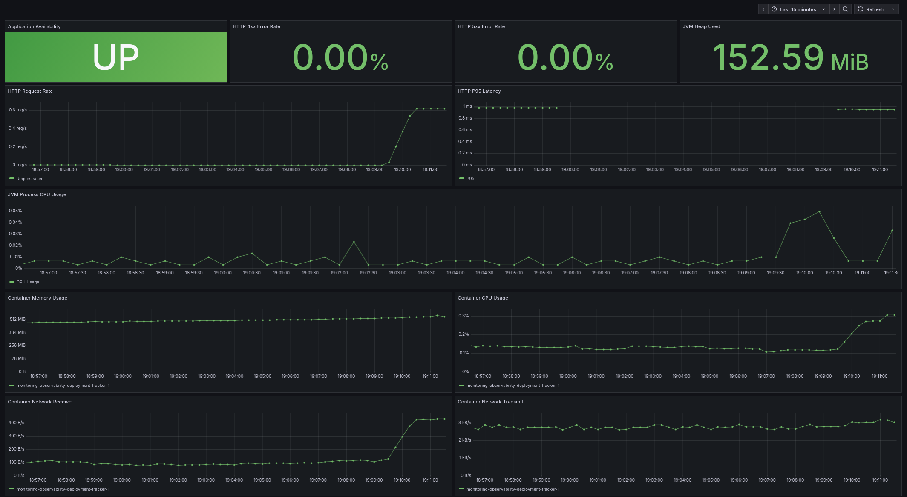

# Monitoring & Observability Stack

A containerized monitoring and observability environment for a Java Spring Boot application, built with Prometheus, Grafana, cAdvisor, and Docker Compose.

The stack monitors the [Deployment Tracker API](https://github.com/nikolasrerras/deployment-tracker) and provides application metrics, JVM monitoring, container resource monitoring, dashboards, and alerting.

## Architecture

```text
                    Docker Compose
┌──────────────────────────────────────────────┐
│                                              │
│  Deployment Tracker API ─── PostgreSQL        │
│            │                                 │
│            │ /actuator/prometheus            │
│            ▼                                 │
│        Prometheus ◄──── cAdvisor             │
│            │              ▲                  │
│            │              │                  │
│            │         Docker Containers       │
│            ▼                                 │
│          Grafana                             │
│            │                                 │
│            ▼                                 │
│        Dashboards                            │
│                                              │
│  Prometheus Alert Rules                      │
└──────────────────────────────────────────────┘
```

## Tech Stack

- Prometheus 3.5
- Grafana 12.2
- cAdvisor 0.60
- Docker & Docker Compose
- Spring Boot Actuator & Micrometer
- PostgreSQL 17
- PromQL

## Features

### Application Monitoring

- Application availability
- HTTP request rate
- HTTP 4xx and 5xx error rates
- HTTP P95 response latency
- JVM heap memory usage
- JVM process CPU usage

### Container Monitoring

- Container CPU usage
- Container memory working set
- Network receive throughput
- Network transmit throughput

Container metrics are collected through cAdvisor.

### Alerting

Prometheus alert rules monitor:

| Alert | Condition |
|---|---|
| DeploymentTrackerDown | API unavailable for 1 minute |
| HighHTTP5xxErrorRate | More than 5% errors with sufficient traffic |
| HighContainerCPU | More than 0.8 CPU cores for 5 minutes |
| HighContainerMemory | More than 800 MiB for 5 minutes |

Alerts are evaluated by Prometheus.

External notifications through Alertmanager are not configured.

## Prerequisites

- Docker Engine
- Docker Compose
- Git
- Docker image `deployment-tracker:local`

The Deployment Tracker source repository must be available to build the application image.

## Getting Started

### 1. Clone the repositories

Clone both repositories into the same parent directory:

```bash
git clone git@github.com:nikolasrerras/deployment-tracker.git
git clone git@github.com:nikolasrerras/monitoring-observability.git

cd monitoring-observability
```

### 2. Build the application image

```bash
docker build -t deployment-tracker:local ../deployment-tracker
```

The application source code remains in its own repository.

### 3. Configure environment variables

```bash
cp .env.example .env
chmod 600 .env
```

Edit `.env` and configure secure passwords:

```dotenv
POSTGRES_PASSWORD=your-secure-password
GRAFANA_ADMIN_PASSWORD=your-secure-password
```

The `.env` file is excluded from Git.

### 4. Start the monitoring stack

```bash
docker compose config --quiet
docker compose up -d
```

Verify the services:

```bash
docker compose ps
```

### 5. Access the services

| Service | URL |
|---|---|
| Deployment Tracker API | http://localhost:8082/api/health |
| Prometheus | http://localhost:9090 |
| Grafana | http://localhost:3000 |
| cAdvisor | http://localhost:8083 |

All exposed ports bind to localhost.

Grafana administrator username: `admin`

The password is configured through `.env`.

## Grafana Dashboard

The dashboard is automatically provisioned from:

```text
dashboards/deployment-tracker.json
```

The Prometheus data source is configured automatically.

The dashboard includes 11 panels covering application health, HTTP performance, JVM metrics, and Docker container resource usage.



## Prometheus Queries

### Application Availability

```promql
up{job="deployment-tracker"}
```

### HTTP Request Rate

```promql
sum(rate(http_server_requests_seconds_count{
  job="deployment-tracker",
  uri!~"/actuator/.*"
}[5m]))
```

### P95 Response Latency

```promql
1000 * histogram_quantile(
  0.95,
  sum by (le) (
    rate(http_server_requests_seconds_bucket{
      job="deployment-tracker",
      uri!~"/actuator/.*"
    }[5m])
  )
)
```

### Container Memory

```promql
sum by (name) (
  container_memory_working_set_bytes{
    job="cadvisor",
    container_label_com_docker_compose_service="deployment-tracker"
  }
)
```

## Alert Rule Testing

Prometheus alert rules are defined in:

```text
prometheus/alerts.yml
```

Automated tests are defined in:

```text
prometheus/alerts.test.yml
```

Run the tests using:

```bash
docker run --rm \
  -v "$PWD/prometheus:/etc/prometheus:ro" \
  --entrypoint promtool \
  prom/prometheus:v3.5.0 \
  test rules /etc/prometheus/alerts.test.yml
```

The tests verify:

- API failure detection
- High HTTP 5xx error rate
- High CPU usage
- High memory usage
- Normal operating conditions

## Incident Simulation

API availability alerting was validated by stopping the application container:

```bash
docker compose stop deployment-tracker
```

Prometheus detected the failed scrape and transitioned the alert through:

```text
Inactive → Pending → Firing
```

After restarting the application:

```bash
docker compose start deployment-tracker
```

The alert returned to `Inactive`.

This verifies both failure detection and service recovery.

## Configuration as Code

The stack uses version-controlled configuration for:

- Docker Compose services
- Prometheus scrape targets
- Prometheus alert rules
- Alert unit tests
- Grafana data sources
- Grafana dashboard provisioning

Persistent Docker volumes retain Prometheus and Grafana data across container restarts.

## Security Notes

- Credentials are loaded from an untracked `.env` file.
- Published service ports are bound to `127.0.0.1`.
- cAdvisor requires privileged host access in this local lab.
- The configuration is intended for local development and demonstration, not an internet-exposed production deployment.

## Stopping the Stack

```bash
docker compose down
```

Named volumes are preserved.

Do not use `docker compose down -v` unless you intentionally want to delete persisted data.
